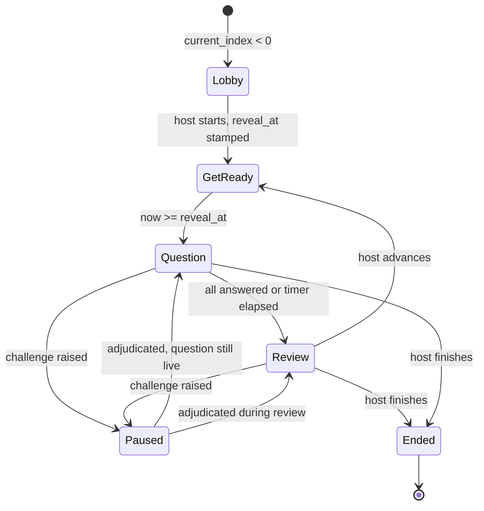
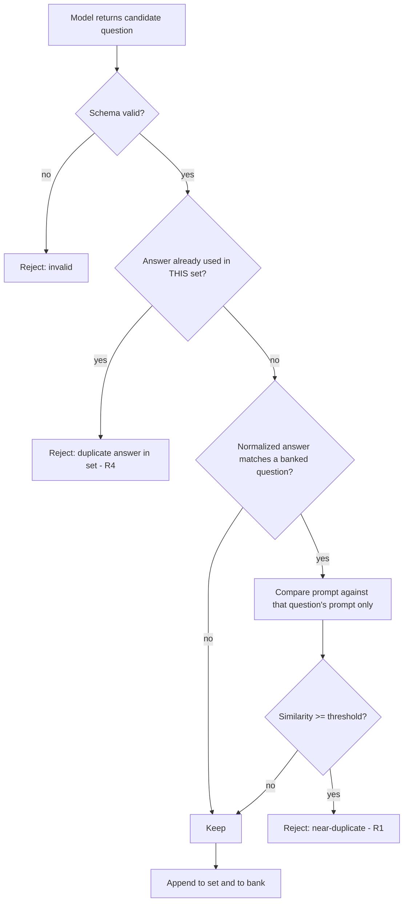
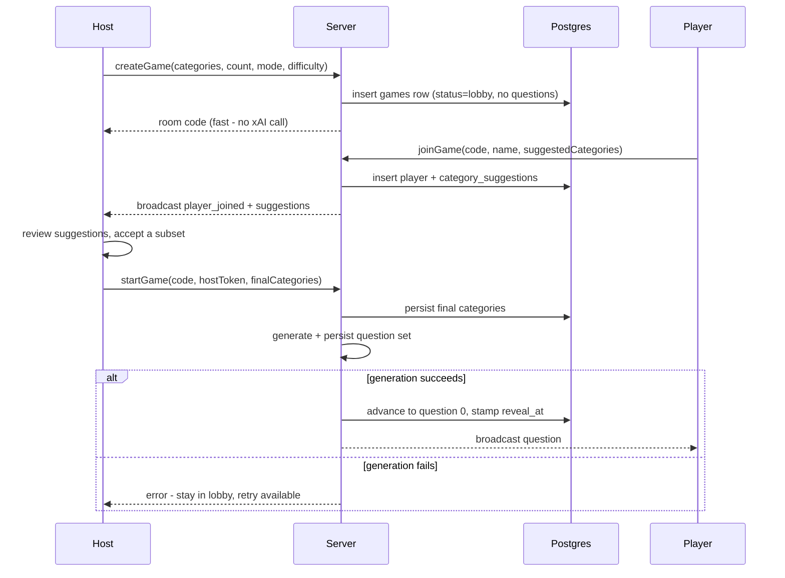

# feat: answer-anchored dedup, host/player parity, and lobby-time category suggestions

**Baseline:** `main` (production). See KTD1 — the current branch
`feat/lead-in-and-host-challenge` is superseded and is not the starting point.

**Product Contract preservation:** No prior requirements artifact existed; this
plan bootstraps its own Product Contract from the user's request plus
`docs/PRODUCT-CHECKLIST.md`. Two checklist statements change as a direct
consequence of this work and are called out in Documentation Impact.

---

## Goal Capsule

Four changes to BUZZR's live game:

1. Stop shipping repeat questions. Duplicate detection becomes **answer-anchored**:
   a candidate is suspect when its correct answer matches a previously-asked
   question's answer, and only those matches get a prompt-similarity test.
2. Once the game starts, host and players see the **same** get-ready, question,
   countdown and review content — one implementation, not two.
3. Both host and players reliably reach the **final results screen**.
4. Players **pick categories on the join screen and submit them to the host** as
   suggestions; the host still decides the final set. Generation moves to game
   start so accepted suggestions actually shape the questions.

---

## Problem Frame

**Duplicates.** Dedup today is normalized-prompt exact match. Two things defeat
it. First, a paraphrase (`"What is the capital of France?"` vs
`"Which city is France's capital?"`) normalizes to different strings and passes
straight through. Second, `app/actions/generate.ts` reads the bank with an
unbounded `select("prompt_norm, prompt")`, which relies on whatever row ceiling
PostgREST applies (Supabase ships a default `max-rows`; confirm the value
configured for this project). Once the bank outgrows that ceiling the exclusion
set becomes a silently truncated subset with no ordering guarantee — and the
model-facing avoid-list is then cut again to the first 40 prompts with no
relation to the categories in play. The
distinct-correct-answer rule exists but only *within* one set
(`usedAnswers` in `lib/generation/xai.ts`), never across games. Net effect: the
longer the bank lives, the weaker dedup gets.

**Parity.** `app/(host)/host/page.tsx` (448 lines) and `app/(play)/play/page.tsx`
(219 lines) independently re-implement the same phase logic — get-ready,
question, countdown, review. They already disagree: the player view handles
voided questions and spectators, the host view does not; the host view shows
`Question N of M` progress and the answer distribution, the player view does not;
the two gate the get-ready window on different conditions. Every future change to
the live loop has to be made twice and the drift compounds.

**Results.** The host renders `GameOver` inline when `status === "ended"`. The
player is *redirected* from `/play` to `/results` by a client-side effect, which
then re-mounts, re-hydrates and re-runs the clock handshake. The redirect is the
only path players have to the end screen, so it depends on the play view being
mounted and reconciling the `results` broadcast.

**Categories.** Players have no visibility into what a game covers and no input.
The blocker is timing: `createGame` generates and persists the whole question set
before the host ever reaches the lobby, so anything a player submits at join time
arrives after the questions exist.

---

## Requirements

| ID | Requirement |
|----|-------------|
| R1 | A generated question is rejected as a duplicate when its normalized correct answer matches a banked question's **and** its prompt is similar to that question's prompt above a threshold. |
| R2 | Answer-only matches with dissimilar prompts are **kept** — two genuinely different questions may share an answer across games. |
| R3 | The exclusion data pulled from the bank at generation is scoped to the categories in play and explicitly bounded, never silently truncated. |
| R4 | Within a single set, no two questions share a correct answer (existing behavior, unchanged). |
| R5 | Once the game starts, host and players render the same get-ready, question text, countdown and review content from one implementation; role differences are limited to affordances (host pacing controls, host-only distribution, player answer input). |
| R6 | Both host and players land on the final results screen when the host finishes the game, without depending on a client-side redirect. |
| R7 | The join screen presents the category catalog; a player selects categories and submits them with their join. |
| R8 | The host sees submitted suggestions live in the lobby and chooses which to accept; players cannot change the game's categories. |
| R9 | Question generation runs when the host starts the game, so accepted suggestions are reflected in the generated set. |
| R10 | A room that exists but has not generated questions is joinable but cannot be started until generation succeeds. |

### Acceptance Examples

| ID | Example |
|----|---------|
| AE1 | The bank holds `"What is the capital of France?"` (answer `Paris`). Generation returns `"Which city is France's capital?"` (answer `Paris`). It is rejected and regenerated. |
| AE2 | The bank holds `"What is the capital of France?"` (answer `Paris`). Generation returns `"Which city hosts the Louvre?"` (answer `Paris`). It is **kept** — same answer, dissimilar prompt. |
| AE3 | A 10-question set is generated with a 5,000-row bank. The exclusion set reflects banked questions in the chosen categories, not the first N rows of the table. |
| AE4 | Host is on the shared screen, a player on a phone. At question 3 both show the same 3-2-1, then the same prompt and the same countdown; the host additionally sees Next question and the answer distribution at review. |
| AE5 | A player is on the question screen when the host taps Finish game. The player's screen becomes the final results screen without a route change. |
| AE6 | A player opens `/join`, enters a code and name, ticks `Science` and `Music`, and joins. The host lobby shows `Science` and `Music` as suggestions from that player. |
| AE7 | The host accepts `Science`, leaves `Music`, and taps Start game. The generated set covers the host's original categories plus `Science` and not `Music`. |
| AE8 | The host taps Start game and generation fails. The host stays in the lobby with an error and a retry; players remain seated and see a waiting state. |

---

## High-Level Technical Design

### Game phase derivation (R5)

Both views today compute this inline, differently. It becomes one pure function.

`Voided` is a modifier on `Question`/`Review` rather than a phase — it changes
what the stage renders, not which stage is active.

### Answer-anchored duplicate detection (R1, R2, R3)

The similarity test never runs over the whole bank — only against the banked
prompts that already share the candidate's answer, which is typically zero or a
handful of rows.

### Deferred generation and suggestion flow (R7, R8, R9, R10)

---

## Key Technical Decisions

**KTD1 — Baseline is `main`; the current branch is superseded.**
`feat/lead-in-and-host-challenge` is 4 commits behind `main` and its
lead-in/host-challenge commits duplicate what `main` already shipped in
`fb6e971` (get-ready countdown, unified end screen, review challenges). The
branch is also missing migrations `0009`/`0010`, which its own code comments
reference. Work starts from a fresh branch off `main`.

**KTD2 — Duplicate detection is answer-anchored, similarity-confirmed.**
The correct answer is the cheap, high-precision anchor: near-duplicate questions
almost always share an answer, and normalized answers are directly indexable. The
expensive comparison (prompt similarity) is then confined to a candidate set that
is nearly always empty. This is the user's stated rule and it also happens to be
the cheapest correct shape.

**KTD3 — Similarity is deterministic and lexical, not embedding-based.**
Token-set overlap (Dice coefficient) over normalized prompts, with a tunable
threshold. Rationale: no new infrastructure, no per-generation API cost, no
`pgvector` extension, and — critically — it is unit-testable offline with fixed
inputs, which an embedding call is not. `docs/PRODUCT-CHECKLIST.md` already lists
embedding-based dedup as out of scope. *Alternative considered:* `pgvector`
embeddings of banked prompts. Better recall on heavy rewrites, but it adds an
extension, a backfill, an embedding API dependency, and per-generation latency —
disproportionate when the anchor already narrows the field to a handful of rows.

**KTD4 — The within-set distinct-answer rule stays strict.**
R1's "same answer + dissimilar prompt is fine" applies **across games only**.
Inside one set, two questions sharing an answer remains a reject (R4), as it is
today. A single quiz with two `Paris` answers reads as a bug to players even when
the questions differ, and relaxing it here would be a regression against a
shipped checklist item. Recorded in Open Questions as a deliberate, reversible
divergence from a literal reading of the request.

**KTD5 — Bank retrieval is scoped and bounded, not unbounded.**
Replace the unbounded `select` with a category-overlapping query carrying an
explicit `limit` and a deterministic order. The current code cannot distinguish
"the bank has 800 rows" from "PostgREST gave me the first 1,000 of 40,000", which
is the failure mode that silently degrades dedup as the product succeeds.

**KTD6 — Generation moves to game start; the room exists from create.**
Required by R9: suggestions collected in the lobby can only matter if generation
has not already happened. Consequence: a joinable room with zero questions
becomes a legal state, and `startGame` — not `createGame` — carries the
generation cost, the concurrency bound, and the failure/retry path.

**KTD7 — Suggestions travel with the join request.**
`joinGame` accepts the selected categories and writes them alongside the player
row, in one round trip. This avoids a pre-join lookup RPC, which would be a new
unauthenticated room-code enumeration surface. The category catalog itself is
already a client-importable constant in `lib/gameConfig.ts`, so the join screen
needs no server call to render the options.

**KTD8 — Parity via a pure phase module plus shared stage components.**
Phase derivation becomes a pure, unit-tested function; both pages render the same
stage components and pass role as props. Role differences (pacing controls,
distribution, answer input) are conditional affordances inside the shared stage,
not parallel view trees. This is what makes the two views unable to drift again.

**KTD9 — Players render the end screen in place.**
`/play` renders `GameOver` when the game ends instead of pushing to `/results`.
`/results` remains as a durable route for direct links and refreshes. Removes the
redirect as a single point of failure and eliminates the re-mount/re-hydrate
flash.

---

## Implementation Units

Grouped into four phases. Phase A is a prerequisite; B, C and D are independent
of each other and can land in any order once A is done.

### Phase A — Baseline

#### U1. Reset the working baseline to `main`

**Goal:** Start from production behavior rather than the superseded branch.
**Requirements:** KTD1.
**Dependencies:** none.
**Files:** none (git + environment only).
**Approach:** Branch fresh from `main`. Confirm the local Supabase project has
migrations `0009_phase_auth_hardening.sql` and `0010_question_count_100.sql`
applied — the current branch's checkout does not contain them, so a stale local
database will fail token and rate-limit paths in confusing ways. Do not merge
`feat/lead-in-and-host-challenge`; its lead-in and host-challenge work is
superseded by `main`'s equivalents.
**Verification:** `npm run typecheck`, `npm test` and `npm run build` all pass on
the fresh branch before any change is made. A locally created game reaches the
lobby.
**Test expectation:** none — no behavior change; this unit establishes the
baseline the rest of the plan is written against.

---

### Phase B — Answer-anchored duplicate detection

#### U2. Answer key extraction, normalization, and bank column

**Goal:** Give every question a comparable answer key and make it queryable on
the bank.
**Requirements:** R1, R3.
**Dependencies:** U1.
**Files:**
- `lib/generation/answerKey.ts` (new)
- `lib/generation/__tests__/answerKey.test.ts` (new)
- `supabase/migrations/0011_question_bank_answer_key.sql` (new)
- `lib/db/types.ts` (modify — add `answer_norm` to the bank row shape)

**Approach:** A pure `answerKey(question)` returns the canonical correct answer
for either mode: for `multiple_choice`, `options[correct_option]`; for
`type_answer`, the first accepted variant (the primary answer). `normalizeAnswer`
reuses the same casing/punctuation/whitespace discipline as
`normalizePrompt` in `lib/generation/dedup.ts` so the two keys behave
consistently. The migration adds a nullable `answer_norm` column to
`question_bank`, backfills it for existing rows where it is derivable, and adds a
non-unique index on `(answer_norm)` — non-unique because R2 explicitly permits
multiple banked questions per answer.
**Patterns to follow:** `lib/generation/dedup.ts` for the normalization shape and
its comment convention explaining *why* the key is what it is; existing
migrations for the `create ... if not exists` / default-deny RLS posture.
**Test scenarios:**
- `answerKey` on a multiple-choice question returns the option at
  `correct_option`, not the first option.
- `answerKey` on a type-answer question returns the first accepted variant.
- `answerKey` returns null (or an explicit sentinel) when `correct_option` is out
  of range, so a malformed row cannot produce a bogus key that matches everything.
- `normalizeAnswer("The Beatles")` and `normalizeAnswer("the beatles!")` collapse
  to the same key.
- `normalizeAnswer` preserves distinct answers that differ only in a word
  (`"New York"` vs `"York"` do not collide).
- Schema test: `question_bank` exposes `answer_norm` and the index exists.

#### U3. Scope and bound the bank read

**Goal:** The exclusion data reflects the categories in play and is never
silently truncated.
**Requirements:** R3.
**Dependencies:** U2.
**Files:**
- `app/actions/generate.ts` (modify)
- `lib/generation/bankQuery.ts` (new — pure query-shaping helpers)
- `lib/generation/__tests__/bankQuery.test.ts` (new)

**Approach:** Replace the unbounded `select("prompt_norm, prompt")` with a query
filtered to rows whose `categories` overlap the categories in play, ordered
deterministically (most recent first), with an explicit `limit` well above any
realistic per-category volume. Return prompts *with* their `answer_norm` so U4
can index candidates by answer without a second round trip. Keep the existing
best-effort posture — a bank read failure logs and degrades rather than blocking
a game — but distinguish "empty result" from "read failed" in the log so a
persistent outage that disables dedup stays detectable. Pass a category-relevant
avoid-list to the model rather than an arbitrary first-40 slice.
**Patterns to follow:** the existing best-effort/log-and-continue handling in
`generateAndPersistQuestions`; Postgres array overlap via the Supabase
`overlaps` filter.
**Test scenarios:**
- The exclusion set built from a bank fixture includes only rows overlapping the
  requested categories.
- A bank larger than the query limit yields exactly `limit` rows, and the plan's
  deterministic ordering is applied (not arbitrary order).
- The avoid-list handed to the model is drawn from the category-scoped rows and
  capped.
- A simulated bank read error leaves generation running with an empty exclusion
  set and emits the distinguishing log line.
- An empty bank produces an empty exclusion set with no error path taken.

#### U4. Answer-anchored similarity gate in generation

**Goal:** Reject near-duplicates, keep genuinely different questions that share
an answer.
**Requirements:** R1, R2, R4.
**Dependencies:** U2, U3.
**Files:**
- `lib/generation/similarity.ts` (new)
- `lib/generation/__tests__/similarity.test.ts` (new)
- `lib/generation/xai.ts` (modify)
- `lib/generation/__tests__/xai.test.ts` (modify)

**Approach:** `similarity.ts` exposes a pure `promptSimilarity(a, b): number`
(token-set Dice over normalized prompts) and an exported threshold constant with
a comment explaining the tuning intent. In `generateQuestions`, the accept path
becomes: schema-valid → not an answer already used in this set (R4, existing
`usedAnswers` behavior retained) → look up banked prompts sharing this
candidate's `answer_norm` → if any exceed the threshold, reject as
`near-duplicate`; otherwise accept. Keep the exact-normalized-prompt check as a
cheap pre-filter. Add `near-duplicate` to the existing `rejections` set so an
exhausted-attempts failure names the real cause. Accepted questions register both
their prompt norm and answer norm so later candidates in the same run compare
against them too.
**Execution note:** Implement `promptSimilarity` and the accept/reject decision
test-first — the threshold behavior is the whole point of the unit and is much
easier to tune against a fixture table than against live generation.
**Patterns to follow:** the existing rejection-tracking and tail-regeneration loop
in `lib/generation/xai.ts`; its injectable `fetchImpl` for deterministic tests.
**Test scenarios:**
- Covers AE1. Candidate `"Which city is France's capital?"` / answer `Paris`
  against a bank entry `"What is the capital of France?"` / `Paris` is rejected
  as `near-duplicate`.
- Covers AE2. Candidate `"Which city hosts the Louvre?"` / answer `Paris` against
  the same bank entry is accepted.
- A candidate whose answer matches nothing in the bank skips the similarity
  comparison entirely (assert via a spy or call counter — the anchor must
  actually be doing the narrowing).
- Two candidates in the same run sharing a correct answer: the second is rejected
  regardless of prompt similarity (R4 unchanged).
- Identical normalized prompt with a *different* answer is still rejected by the
  existing prompt-norm check.
- `promptSimilarity` is symmetric, returns 1 for identical normalized prompts and
  0 for fully disjoint token sets.
- Rejections drive tail regeneration: a batch where half the questions are
  near-duplicates still fills the requested count within the attempt budget.
- Exhausted attempts throw `GenerationError` naming `near-duplicate` among the
  rejection reasons.

---

### Phase C — Host/player parity

#### U5. Pure phase derivation module

**Goal:** One authority on what the room is currently showing.
**Requirements:** R5.
**Dependencies:** U1.
**Files:**
- `lib/gamePhase.ts` (new)
- `lib/__tests__/gamePhase.test.ts` (new)

**Approach:** `derivePhase(game, offset)` returns a discriminated union over
`lobby | get_ready | question | review | paused | ended`, computed from
`current_index`, `status`, `reveal_at`, `paused` and `reviewing` — the exact
inputs the two pages each evaluate inline today, unified into the precedence the
state diagram above defines. Voided is surfaced as a flag on the question/review
phases, not a phase. Kept separate from `lib/gameFlow.ts`, which is host pacing
logic (`isLastIndex`, `shouldAutoClose`); this module is view-facing.
**Execution note:** Test-first. This function is the contract both views will
depend on, and getting the precedence wrong is the main regression risk in Phase C.
**Patterns to follow:** `lib/gameFlow.ts` for pure-module shape and test style;
`isGetReadyPhase` in `lib/realtime/clock.ts` for the offset-corrected timing check
this should call rather than reimplement.
**Test scenarios:**
- `current_index === -1` yields `lobby` regardless of other fields.
- `status === "ended"` yields `ended` even when `paused` or `reviewing` is true.
- `paused` takes precedence over `reviewing` and over an active question.
- Before `reveal_at` (offset-corrected) yields `get_ready`; after, `question`.
- `reviewing` yields `review` even when the countdown has not elapsed (the
  all-answered path).
- A voided current question yields `question`/`review` with the voided flag set,
  not a separate phase.
- A non-zero clock offset shifts the get-ready boundary in the expected direction.

#### U6. Shared in-game stage components

**Goal:** Host and player render the same live-game content from one
implementation.
**Requirements:** R5.
**Dependencies:** U5.
**Files:**
- `components/GameStage.tsx` (new — phase switch, renders the stage below)
- `components/QuestionStage.tsx` (new)
- `components/ReviewStage.tsx` (new)
- `components/__tests__/GameStage.test.tsx` (new)
- `app/(host)/host/page.tsx` (modify)
- `app/(play)/play/page.tsx` (modify)
- `app/globals.css` (modify — shared stage styles)

**Approach:** `GameStage` takes the derived phase plus a `role` and renders
get-ready, question (prompt, countdown, options/answer input), or review (reveal,
distribution, challenge affordances). Both pages keep their own shells — the host
keeps its room header, roster, pacing buttons, adjudication panel and lobby; the
player keeps its identity header and waiting state — and both delegate the live
content to `GameStage`. Role-conditional affordances inside the stage: pacing
controls and the answer distribution are host-only; the answer input renders for
anyone holding a player token (which includes a host who plays); voided and
spectator overlays now render for both roles because they live in the shared
stage. The host's auto-close effect, challenge adjudication and start/finish
controls stay on the host page — they are pacing authority, not presentation.
**Execution note:** Characterization-first. Before extracting, capture the current
host and player rendering for each phase so the refactor is verifiably
behavior-preserving; `e2e/game-flow.spec.ts` is the existing safety net for the
end-to-end path.
**Patterns to follow:** existing shared components consumed by both pages
(`AnswerPanel`, `GetReady`, `Countdown`, `AnswerReveal`, `ChallengeActions`) —
this unit extends that pattern upward to the stage level rather than inventing a
new one.
**Test scenarios:**
- Covers AE4. Given the same game state, host and player renders contain the same
  question prompt and the same countdown value.
- `get_ready` phase renders the 3-2-1 for both roles and renders no answer input.
- `question` phase renders the answer input when a player token is present and
  omits it for a host-only gamemaster, who instead sees the options read-only.
- Type-answer mode for a host-only gamemaster renders the prompt and countdown
  (today's host view renders options only for multiple choice, leaving type-answer
  visibly emptier than the player view).
- A voided current question renders the voided overlay for **both** roles.
- A spectator renders the sitting-out overlay and no answer input.
- `review` phase renders the correct answer for both roles; the distribution
  renders only for the host.
- `paused` renders the paused overlay for both roles and suppresses the answer
  input.
- Challenge affordances render for a player and for a host who plays; not for a
  spectator.

#### U7. Unified end screen for both roles

**Goal:** Every participant reliably reaches the final results screen.
**Requirements:** R6.
**Dependencies:** U5.
**Files:**
- `app/(play)/play/page.tsx` (modify — render `GameOver` in place, drop the
  redirect effect)
- `app/(play)/results/page.tsx` (modify — keep as a direct-link route)
- `components/__tests__/GameOver.test.tsx` (new)

**Approach:** When the derived phase is `ended`, `/play` renders `GameOver`
directly, matching what the host page already does. `/results` stays as a route
for refreshes and shared links and continues to hydrate on mount. The player's
credential is already in tab session storage on both paths, so `myPlayerId` and
personal placement work identically in either.
**Patterns to follow:** the host page's `{ended && <GameOver ... />}` block —
this unit makes the player path structurally identical to it.
**Test scenarios:**
- Covers AE5. A game transitioning to `ended` while the play view is mounted
  renders the final standings without a route change.
- The `/results` route still renders standings when opened directly with a valid
  stored credential.
- A spectator (absent from the leaderboard) sees the standings and no personal
  placement card, on both paths.
- The end screen shows the same standings order for host and player given the
  same leaderboard payload.
- Hydration has not yet returned: the loading state renders rather than an empty
  "no winner" screen.

---

### Phase D — Lobby-time categories

#### U8. Defer generation to game start

**Goal:** The question set is generated when the host starts, not when the room
is created.
**Requirements:** R9, R10.
**Dependencies:** U1.
**Files:**
- `app/actions/createGame.ts` (modify)
- `app/actions/startGame.ts` (new)
- `app/actions/advance.ts` (modify — start path)
- `lib/gameFlow.ts` (modify — add a can-start guard)
- `lib/__tests__/gameFlow.test.ts` (modify)
- `app/(host)/setup/page.tsx` (modify — submit no longer waits on generation)
- `app/(host)/host/page.tsx` (modify — lobby generating/error state)

**Approach:** `createGame` inserts the game row and seats the host, and returns
the room code without calling xAI. A new host-token-gated `startGame` action
persists the final category set, runs `generateAndPersistQuestions`, and only then
advances to question 0. The abuse guards move with the work: the per-IP rate limit
stays on create (room creation is still the enumerable action), while the
concurrent-generation bound and the xAI cost exposure move to `startGame`, which
additionally requires a valid host token — a strictly tighter surface than today's
anonymous-create path. Rollback semantics invert: a generation failure no longer
deletes the room, it leaves the host in the lobby with an error and a retry, and
players stay seated (AE8). Add a guard so a room with zero questions cannot be
advanced (R10).
**Execution note:** Test-first on the `startGame` authorization and phase guards —
this unit widens what states a joinable room can be in, and the guard is what
keeps that safe.
**Patterns to follow:** `authorizeHostByCode` in `lib/serverAuth.ts` for host
token gating; the existing rate-limit and concurrency guards in `createGame` for
what to move and what to keep; `advance.ts` for the CAS-style index handling.
**Test scenarios:**
- Covers AE8. `startGame` with a generation failure leaves the game in `lobby`
  status with zero questions and surfaces the error; a retry then succeeds.
- `createGame` returns a room code without invoking the generation path (assert
  the xAI fetch is never called).
- `startGame` with an invalid or missing host token is rejected and generates
  nothing.
- `startGame` on a game that already has questions and is `active` is a no-op
  rather than a second generation (double-tap protection).
- Advancing a room with zero questions is rejected by the guard.
- A player joining a room with no questions yet is seated normally and sees the
  waiting state.
- Per-IP create rate limiting still applies to `createGame`.
- The concurrent-generation bound applies to `startGame` and returns the busy
  error past the ceiling.

#### U9. Player category suggestions at join

**Goal:** Players pick categories on the join screen and submit them with their
join.
**Requirements:** R7.
**Dependencies:** U8.
**Files:**
- `supabase/migrations/0012_category_suggestions.sql` (new)
- `lib/suggestions.ts` (new — validation and aggregation, pure)
- `lib/__tests__/suggestions.test.ts` (new)
- `app/actions/joinGame.ts` (modify — accept and persist suggestions)
- `app/(play)/join/page.tsx` (modify — category picker)
- `components/CategoryPicker.tsx` (new)
- `lib/db/types.ts` (modify)
- `lib/realtime/events.ts` (modify — suggestion event)

**Approach:** A `category_suggestions` table keyed on `(game_id, player_id,
category)` with default-deny RLS, written only by the service-role join action.
The join form renders the catalog from the `CATEGORIES` constant in
`lib/gameConfig.ts` — no server call and no pre-join lookup (KTD7) — and passes
the selection to `joinGame`, which validates it against the same constant and the
per-player cap before inserting. Suggestions are only accepted while the game is
in `lobby`. The existing `player_joined` broadcast carries the suggestion so the
host lobby reconciles live through the one room channel.
**Patterns to follow:** `validateSetupInput` in `lib/gameConfig.ts` for
validating a category array against the catalog; `joinGame`'s existing
normalize-then-validate-then-insert order and its broadcast call; migrations
`0001`/`0005` for the default-deny RLS posture.
**Test scenarios:**
- Covers AE6. Joining with `["Science", "Music"]` persists exactly those two
  suggestions against that player.
- Joining with an empty selection succeeds — suggestions are optional.
- A category not in the catalog is rejected without seating the player, or is
  dropped, per the validation contract the unit settles; the test asserts the
  chosen behavior explicitly.
- A selection over the per-player cap is rejected with a clear message.
- Duplicate categories in one submission collapse to one row.
- Suggestions submitted to a game already in `active` or `ended` status are
  rejected while the join itself follows existing status rules.
- The join broadcast payload includes the suggested categories.
- Schema test: the table exists with its uniqueness constraint and RLS enabled.

#### U10. Host lobby suggestion review

**Goal:** The host sees suggestions live and decides the final category set.
**Requirements:** R8, R9.
**Dependencies:** U9.
**Files:**
- `app/(host)/host/page.tsx` (modify — suggestions panel in the lobby)
- `components/SuggestionsPanel.tsx` (new)
- `components/__tests__/SuggestionsPanel.test.tsx` (new)
- `supabase/migrations/0012_category_suggestions.sql` (modify — host-gated read RPC;
  U9 and U10 co-author this one migration file, which is safe because both land
  before it is applied anywhere)
- `lib/realtime/channel.ts` (modify — call the RPC)
- `app/actions/startGame.ts` (modify — accept the host's final category set)
- `docs/PRODUCT-CHECKLIST.md` (modify)

**Approach:** A host-token-gated RPC returns suggested categories for the game
with a count and the suggesting players, following the `list_open_challenges`
pattern in migration `0003`. The lobby renders them as accept/ignore toggles;
accepted categories merge into the host's set, respecting the existing category
cap, and travel to `startGame`. Nothing a player submits changes the game's
categories until the host accepts it (R8).
**Patterns to follow:** `list_open_challenges` for the host-gated RPC shape and
its `revoke`/`grant` posture; the host page's existing effect that loads
challenges while paused and refreshes on state reconcile.
**Test scenarios:**
- Covers AE7. Host accepts `Science`, ignores `Music`, starts; the categories
  passed to generation include the host's originals plus `Science` and exclude
  `Music`.
- Suggestions from multiple players for the same category aggregate to one entry
  with a count.
- Accepting suggestions that would exceed the category cap is prevented with a
  clear message.
- A suggestion the host never accepts has no effect on generation.
- The panel renders empty-state copy when no suggestions have arrived.
- The RPC rejects a player token and a missing token.
- A suggestion arriving after the host opened the lobby appears without a manual
  refresh.

---

## Scope Boundaries

**In scope:** duplicate detection, host/player in-game and end-screen parity,
deferred generation, player category suggestions.

**Non-goals:** scoring and speed-score behavior, challenge adjudication rules,
host pacing authority, the visual redesign, accounts or history.

### Deferred to Follow-Up Work

- Embedding-based semantic dedup (`pgvector`). KTD3 covers why the lexical test is
  the right first move; revisit if AE1-class duplicates still get through after
  threshold tuning.
- Serving a question directly from the bank without an xAI call. The bank already
  stores full question rows for this; nothing here depends on it.
- Suggestion visibility to other players, or voting on suggestions.
- Reconciling anything unique in `feat/lead-in-and-host-challenge`. KTD1 treats it
  as superseded; if a later audit finds something `main` lacks, that is its own
  piece of work.

---

## System-Wide Impact

- **Host setup UX changes shape.** Submit becomes fast (no generation wait) and
  the wait moves to Start game. The "generating" affordance moves from the setup
  page to the lobby.
- **A new legal room state exists**: joinable, zero questions. Every code path
  that assumes a lobby game has questions needs the U8 guard.
- **Two migrations** (`0011`, `0012`) must be applied before the corresponding
  code paths are exercised. `0011` includes a backfill over existing bank rows.
- **Players are affected** by every one of these four changes; the host is
  affected by three. Nothing changes for a spectator beyond the parity fixes,
  which give them a correct voided/sitting-out overlay on both roles' screens.

---

## Risks & Dependencies

| Risk | Mitigation |
|------|-----------|
| The Phase C extraction regresses the live loop — the highest-value, least-forgiving path in the app. | U5 lands as a pure, fully-tested module before any component moves; U6 is characterization-first; `e2e/game-flow.spec.ts` and `e2e/reconnect.spec.ts` gate the refactor. |
| The similarity threshold over-rejects, exhausting the attempt budget and failing generation loudly. | Threshold is a named exported constant with a rejection-reason path already wired; U4 tests include a fill-the-count-despite-rejections scenario. Tune against real bank data at execution. |
| Deferred generation makes Start game slow enough to feel broken with a room full of waiting players. | Lobby generating state for the host and a waiting state for players (AE8 path); question count already bounds generation time. |
| `answer_norm` backfill is incomplete for older bank rows with malformed answer keys. | Column is nullable and the index non-unique; rows without a key simply never anchor a match, degrading to today's prompt-only behavior rather than failing. |
| Moving generation off `createGame` weakens a cost guard. | Net tighter: `startGame` requires a valid host token where create is anonymous. The concurrency bound moves with the work; the per-IP create limit stays. |
| Migration numbering collides if other work lands first. | Renumber at execution; nothing in the plan depends on the literal numbers. |

---

## Open Questions

**Deferred to implementation:**
- The similarity threshold value. Needs real bank data; the fixture tests pin
  behavior at whatever value is chosen, not the value itself.
- The bank query's row limit, and whether category overlap needs a supporting
  index on `question_bank.categories` at current data volumes.
- Whether an out-of-catalog suggested category is rejected or silently dropped
  (U9 test scenarios require the choice be made explicitly and asserted).
- The per-player suggestion cap.

**Product question, deliberately decided here (KTD4):** the request read
literally would also loosen the *within-set* distinct-answer rule to
"same answer + dissimilar prompt is fine". This plan keeps the within-set rule
strict and applies the new rule across games only. Reversing this is a one-line
change in U4 if you want a single set to be able to contain two questions that
both answer `Paris`.

---

## Documentation Impact

`docs/PRODUCT-CHECKLIST.md` needs three edits, folded into U10:

- §2: "on success, room is created and host is taken to the host lobby" and
  "Generation failure surfaces error with Retry / Back to edit; no
  half-initialized joinable game left behind" — generation now happens at start,
  and a joinable room with no questions is expected, not a half-initialized game.
- §3: the no-shared-correct-answer item gains its cross-game clause (same answer
  is permitted across games when the prompts are dissimilar).
- §4: add the player category-suggestion behavior and the host's final say.

The out-of-scope list keeps its embedding-dedup entry (KTD3) and should note that
lexical, answer-anchored dedup now exists.

---

## Verification Contract

- `npm run typecheck`, `npm run lint`, `npm test` pass.
- `npm run test:e2e` passes against a live environment with migrations through
  `0012` applied — specifically `e2e/game-flow.spec.ts` (the Phase C safety net)
  and `e2e/reconnect.spec.ts`.
- Manual pass on a real room, two devices: host on a shared screen, player on a
  phone. Host creates (fast), player joins with suggested categories, host accepts
  a subset and starts, both screens show the same 3-2-1 / question / countdown /
  review, and both land on the final results screen.
- Duplicate check: generate two consecutive games on overlapping categories and
  confirm no near-duplicate prompt appears across them.

## Definition of Done

All ten units are implemented with their test scenarios passing; the Verification
Contract gates are green; migrations `0011` and `0012` are applied and their
schema tests pass; `docs/PRODUCT-CHECKLIST.md` reflects the three behavior changes
above; and the work sits on a branch taken from `main`.
